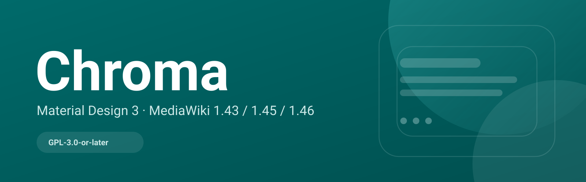

<p align="center">
  
</p>

<h1 align="center">Chroma Docs</h1>

<p align="center">
  <strong>The official documentation and website for Chroma</strong><br>
  <sub>Chinese by default · English available</sub>
</p>

<p align="center">
  <a href="README.md">简体中文</a> ·
  <a href="https://chroma-mediawiki.github.io/chroma-docs/en/">English site</a> ·
  <a href="https://chroma-mediawiki.github.io/chroma-docs/">Chinese site</a> ·
  <a href="https://github.com/chroma-mediawiki/mediawiki-skins-Chroma">Skin repository</a>
</p>

<p align="center">
  <a href="https://chroma-mediawiki.github.io/chroma-docs/en/"></a>
  <a href="https://github.com/chroma-mediawiki/chroma-docs/actions/workflows/pages.yml"></a>
  <a href="https://github.com/chroma-mediawiki/chroma-docs/blob/main/LICENSE"></a>
  <a href="https://vitepress.dev/"></a>
</p>

<p align="center">
  
</p>

## What this repository is

This repository contains the **documentation site** for Chroma, not the skin code.
The skin, release packages and extension matrix live in
[mediawiki-skins-Chroma](https://github.com/chroma-mediawiki/mediawiki-skins-Chroma).

- English site: https://chroma-mediawiki.github.io/chroma-docs/en/
- Chinese site: https://chroma-mediawiki.github.io/chroma-docs/
- Language detection: Chinese browsers open the Chinese site; every other language opens English.

## Documentation map

| I want to… | Go to |
|---|---|
| Install Chroma | [Installation](https://chroma-mediawiki.github.io/chroma-docs/en/guide/installation) |
| Change theme/layout | [Configuration](https://chroma-mediawiki.github.io/chroma-docs/en/guide/configuration) |
| Learn the interface | [Interface & navigation](https://chroma-mediawiki.github.io/chroma-docs/en/guide/usage) |
| Use MobileFrontend | [Mobile](https://chroma-mediawiki.github.io/chroma-docs/en/guide/mobile) |
| Change tokens / release | [Development](https://chroma-mediawiki.github.io/chroma-docs/en/dev/) |
| Check extension support | [Compatibility](https://chroma-mediawiki.github.io/chroma-docs/en/guide/compatibility) |

## Local development

```bash
npm install --include=dev
npm run dev
```

Build and preview:

```bash
npm run build
npm run preview
```

Pushes to `main` deploy through `.github/workflows/pages.yml` to GitHub Pages.

## Layout

```text
docs/
  .vitepress/        VitePress config + custom theme
  guide/             Chinese guide
  dev/               Chinese development docs
  en/                English site
  public/            logo, screenshots, robots.txt
internal/docs/       reference docs moved out of the skin repository
```

## License

Documentation and site code: GPL-3.0-or-later. Chroma is an independent community project, not affiliated with Google.
