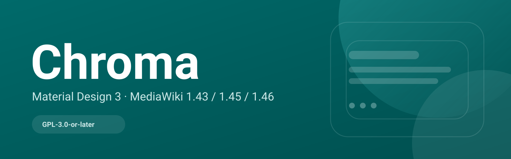
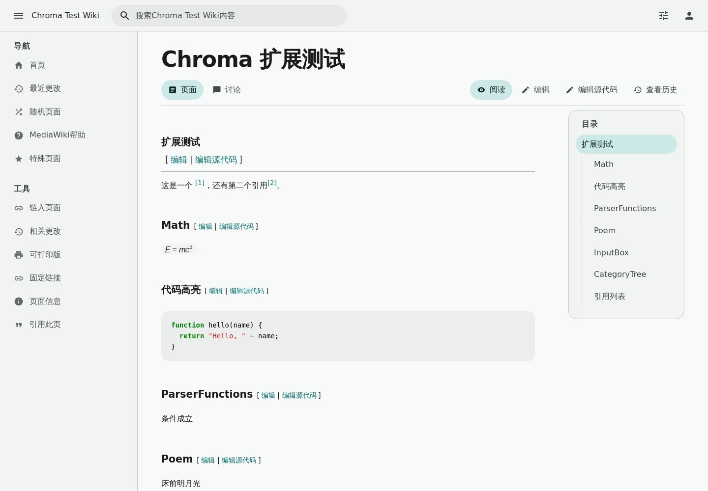
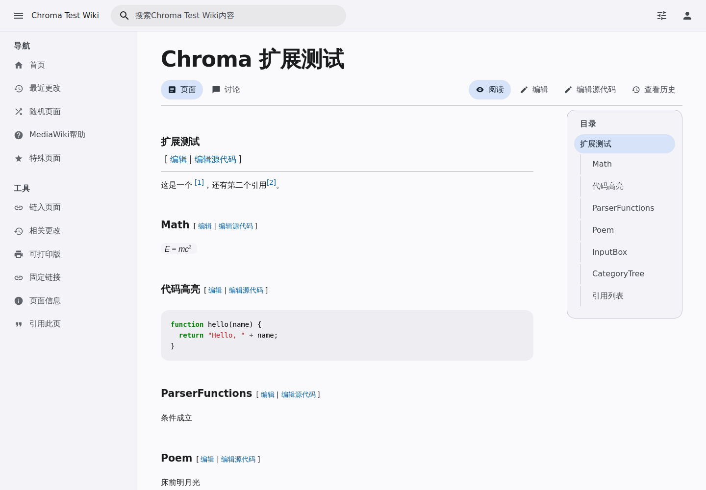
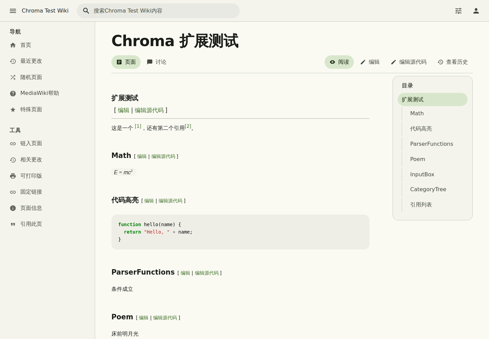
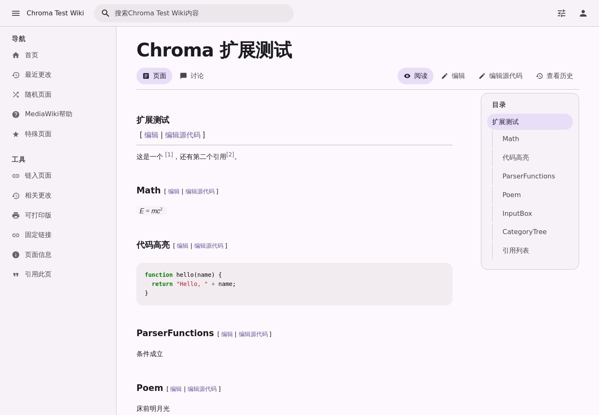
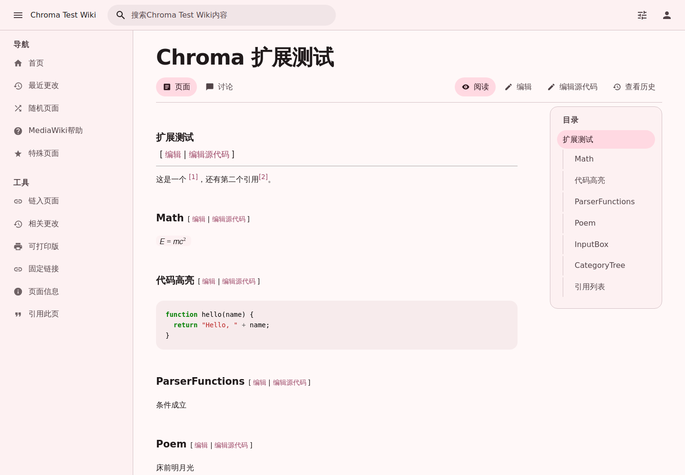
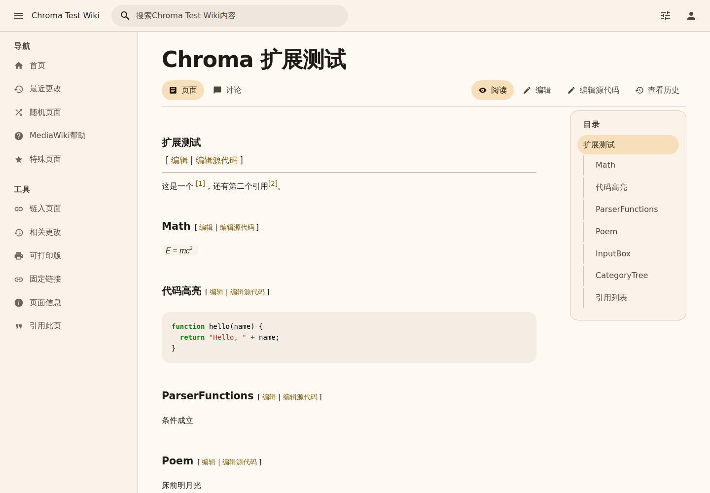
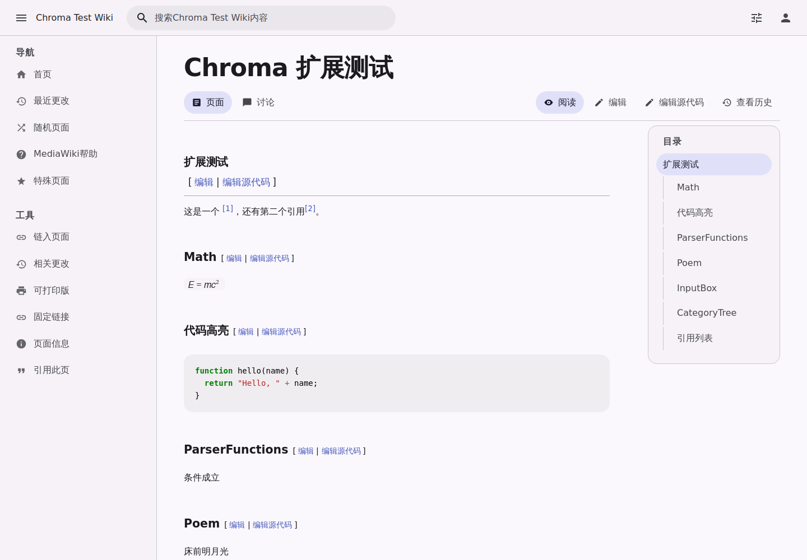
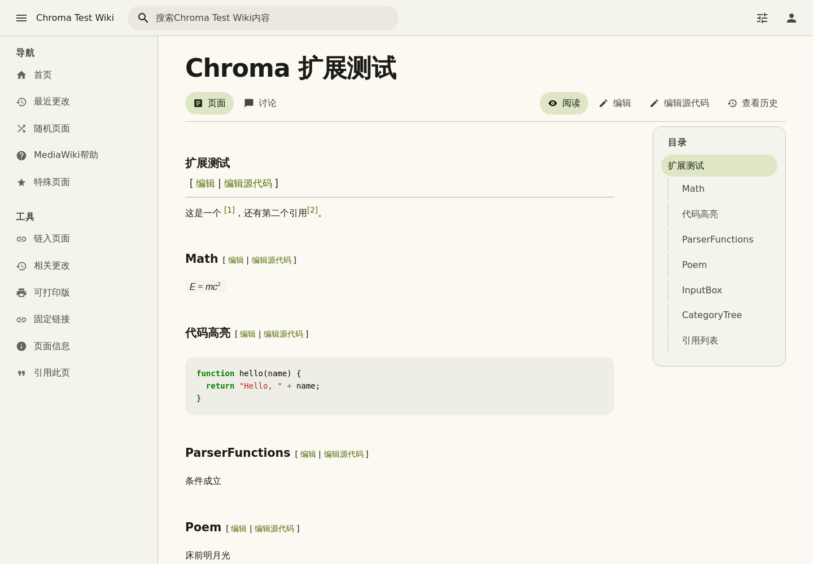

<p align="center">
  
</p>

<h1 align="center">Chroma Docs</h1>

<p align="center">
  <strong>Chroma 的官方文档与官网</strong><br>
  <sub>中文默认 · English available</sub>
</p>

<p align="center">
  <a href="README.en.md">English</a> ·
  <a href="https://chroma-mediawiki.github.io/">中文官网</a> ·
  <a href="https://chroma-mediawiki.github.io/en/">English site</a> ·
  <a href="https://github.com/chroma-mediawiki/mediawiki-skins-Chroma">皮肤仓库</a> ·
  <a href="https://qm.qq.com/q/zSaZRWS4eY">QQ</a> ·
  <a href="https://b23.tv/QiGlLcm">Bilibili</a>
</p>

<p align="center">
  <a href="https://chroma-mediawiki.github.io/"></a>
  <a href="https://github.com/chroma-mediawiki/chroma-mediawiki.github.io/actions/workflows/pages.yml"></a>
  <a href="https://github.com/chroma-mediawiki/chroma-mediawiki.github.io/blob/main/LICENSE"></a>
  <a href="https://vitepress.dev/"></a>
  <a href="https://qm.qq.com/q/zSaZRWS4eY"></a>
  <a href="https://b23.tv/QiGlLcm"></a>
</p>

<p align="center">
  
</p>

## 八套预设

| Teal | Blue | Green | Violet |
|---|---|---|---|
|  |  |  |  |
| **Rose** | **Amber** | **Indigo** | **Lime** |
|  |  |  |  |

## 这是什么

这个仓库只包含 Chroma 的**文档站**，不包含皮肤代码。皮肤本体、发行包和扩展矩阵在
[mediawiki-skins-Chroma](https://github.com/chroma-mediawiki/mediawiki-skins-Chroma)。

- 中文站点：https://chroma-mediawiki.github.io/
- English site: https://chroma-mediawiki.github.io/en/
- 默认按浏览器语言选择：中文浏览器进中文版，其他语言进英文版。

## 文档入口

| 你想做什么 | 去哪里 |
|---|---|
| 安装 Chroma | [安装](https://chroma-mediawiki.github.io/guide/installation) |
| 改默认主题/布局 | [配置](https://chroma-mediawiki.github.io/guide/configuration) |
| 了解页面与快捷键 | [界面与导航](https://chroma-mediawiki.github.io/guide/usage) |
| 接 MobileFrontend | [移动端](https://chroma-mediawiki.github.io/guide/mobile) |
| 改 token / 发版 | [开发文档](https://chroma-mediawiki.github.io/dev/) |
| 查扩展兼容性 | [兼容性](https://chroma-mediawiki.github.io/guide/compatibility) |

## 本地开发

```bash
npm install --include=dev
npm run dev
```

构建与预览：

```bash
npm run build
npm run preview
```

推送到 `main` 后由 `.github/workflows/pages.yml` 自动部署到 GitHub Pages。

## 结构

```text
docs/
  .vitepress/        VitePress config + custom theme
  guide/             中文指南
  dev/               中文开发文档
  en/                英文站点
  public/            logo、截图、robots.txt
internal/docs/       从皮肤仓库迁出的内部参考文档（不参与站点构建）
```

## 许可

文档与站点代码：GPL-3.0-or-later。Chroma 是独立社区项目，与 Google 无关联。
